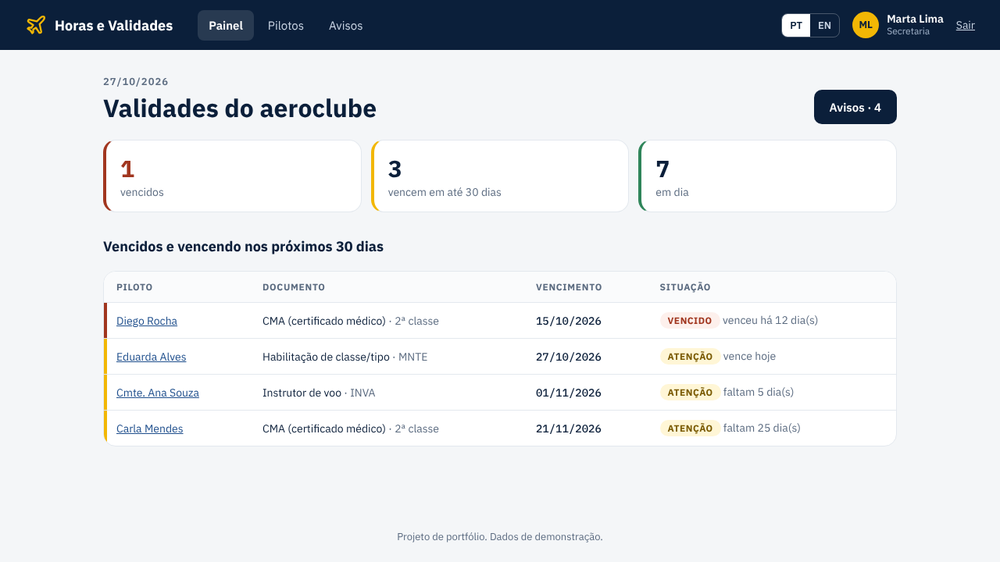
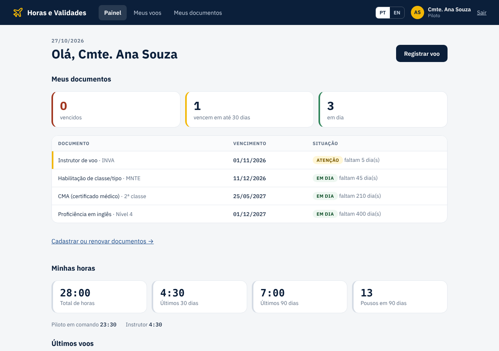
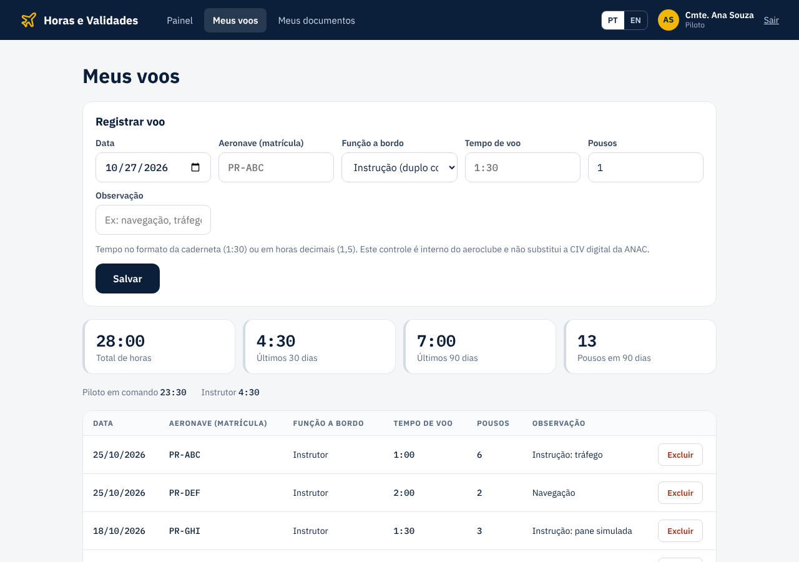
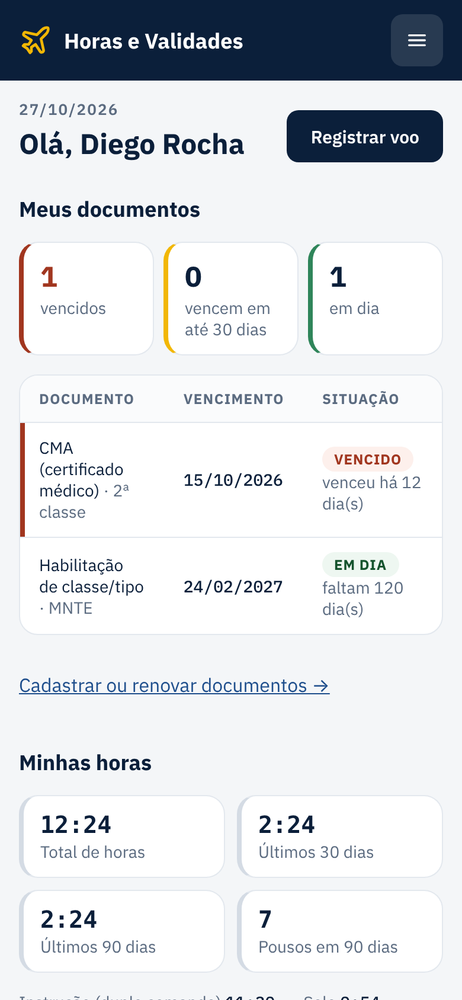

# ✈️ Horas e Validades · Hours & Currency

[](https://github.com/joaopedrorf/controle-horas-validades/actions/workflows/testes.yml)


🇧🇷 [Português](#-português) · 🇺🇸 [English](#-english)



## 🇧🇷 Português

Sistema web para aeroclubes e escolas de aviação acompanharem as horas de voo dos pilotos e o vencimento dos documentos (CMA, habilitações, proficiência em inglês), com aviso por e-mail antes de vencer.

### O que ele faz

- **Login** com dois perfis: piloto (ou aluno) e secretaria.
- **Documentos com semáforo**: cada documento aparece como *vencido* (vermelho), *atenção* (vence em até 30 dias, amarelo) ou *em dia* (verde), com quantos dias faltam.
- **Renovação em um passo**: o piloto digita a nova data de vencimento e o semáforo atualiza na hora.
- **Avisos por e-mail** 30 dias antes, 7 dias antes e no dia do vencimento, para o piloto com cópia para a secretaria. Cada aviso sai uma vez só; documento renovado volta a receber avisos no próximo ciclo.
- **Registro de voos**: data, matrícula, função a bordo (instrução, solo, piloto em comando, instrutor), tempo no formato da caderneta (1:30) ou decimal (1,5) e pousos.
- **Resumo de horas**: total, últimos 30 e 90 dias, pousos em 90 dias e horas por função.
- **Painel da secretaria**: todos os documentos vencidos ou vencendo do aeroclube numa tela só, lista de pilotos e histórico dos avisos enviados.
- **Bilíngue**: português e inglês, trocando com um clique (o e-mail de aviso vai nos dois idiomas).
- **Funciona no celular.**

| Painel do piloto | Registro de voos | Celular |
|---|---|---|
|  |  |  |

**O que ele não faz, de propósito:** não calcula a validade dos documentos. A validade do CMA, por exemplo, muda com a classe e a idade do piloto; por isso o piloto digita a data que está no documento. Também não substitui a CIV digital da ANAC: é o controle interno do aeroclube.

### Como funcionam os avisos

`avisos.py` procura os documentos que chegaram a 30, 7 ou 0 dias do vencimento e ainda não foram avisados. O envio pode ser feito:

- pelo botão **Enviar agora**, na tela *Avisos* da secretaria;
- pelo comando `flask --app app enviar-avisos`;
- automaticamente todo dia às 7h, pelo GitHub Actions (`.github/workflows/avisos.yml`), que chama o site. O plano grátis do Render não tem tarefa agendada, então o GitHub faz o papel de despertador.

Sem servidor de e-mail configurado (como na demonstração), os avisos são só registrados na tela como *simulados*.

### Tecnologias

Python, Flask, SQLAlchemy (SQLite no computador, PostgreSQL em produção), Flask-Login, envio de e-mail com `smtplib`, GitHub Actions (testes e agendamento) e testes com pytest. Mesmo visual da [Agenda de Aeronaves](https://github.com/joaopedrorf/agenda-aeronaves), em HTML e CSS puros.

### Segurança e dados

- **Senhas** guardadas só como *hash* (scrypt, via Werkzeug), nunca como texto.
- **Login** bloqueado por 15 minutos depois de 5 senhas erradas; a mesma mensagem para e-mail inexistente e senha errada.
- **Formulários** com token CSRF e **cookies** protegidos (`HttpOnly`, `SameSite=Lax`, `Secure` em produção).
- **Permissões**: o piloto só vê e altera os próprios voos e documentos; só a secretaria vê todos e cadastra pessoas.
- **Rota do agendador** protegida por um token secreto; sem token configurado, ela nem existe (responde 404).
- **Cabeçalhos de segurança** (Content-Security-Policy, X-Frame-Options e outros).
- **Fuso horário**: "vence hoje" segue o horário do aeroclube (`FUSO_HORARIO`, padrão Brasília), mesmo com o servidor em outro país.
- Na demonstração online o banco é recriado a cada reinício: nenhum dado real fica guardado.

### Estrutura do projeto

| Arquivo | O que faz |
|---|---|
| `app.py` | Rotas e telas (login, painel, voos, documentos, pilotos, avisos) |
| `validades.py` | Regras: situação do documento, dias restantes, marcos de aviso, soma de horas |
| `avisos.py` | Monta e envia os e-mails de vencimento |
| `modelos.py` | Tabelas do banco: usuário, documento, voo, aviso |
| `seguranca.py` | Limite de tentativas de login e cabeçalhos de segurança |
| `textos.py` | Todos os textos em português e inglês |
| `demo.py` | Aeroclube fictício para a demonstração |
| `tests/` | 38 testes automáticos, que rodam no GitHub a cada envio |

### Como rodar

```bash
pip install -r requirements.txt
python app.py
```

Abra http://127.0.0.1:5000 e entre com uma das contas de demonstração (senha `demo123`):

| E-mail | Perfil |
|---|---|
| admin@demo.com | Secretaria |
| diego@demo.com | Piloto com CMA vencido |
| ana@demo.com | Instrutora com habilitação vencendo |

Para rodar os testes: `python -m pytest`

### Configuração

Copie `.env.exemplo` para `.env`. Variáveis:

- `SECRET_KEY`: frase secreta usada para proteger o login.
- `DATABASE_URL`: endereço do PostgreSQL. Sem ela, usa um arquivo SQLite local.
- `DEMO`: `1` cria dados de exemplo quando o banco está vazio; `0` começa limpo.
- `SMTP_HOST`, `SMTP_PORTA`, `SMTP_USUARIO`, `SMTP_SENHA`, `EMAIL_REMETENTE`: servidor de e-mail dos avisos.
- `AVISOS_TOKEN`: senha que o agendador do GitHub usa para pedir o envio diário.

### Publicar no Render

O arquivo `render.yaml` já traz a configuração: no Render, clique em **New > Blueprint** e escolha este repositório.

---

## 🇺🇸 English

A web app for flying clubs and flight schools to track pilots' flight hours and document expiry dates (medical certificate, ratings, English proficiency), with e-mail reminders before anything expires.

### Features

- **Sign in** with two roles: pilot (or student) and front desk.
- **Traffic-light documents**: each document shows as *expired* (red), *due soon* (within 30 days, yellow) or *current* (green), with the days left.
- **One-step renewal**: the pilot enters the new expiry date and the status updates right away.
- **E-mail reminders** 30 days before, 7 days before and on the expiry date, sent to the pilot with a copy to the front desk. Each reminder goes out once; a renewed document gets reminders again in its next cycle.
- **Flight log**: date, registration, role on board (dual, solo, pilot in command, instructor), time in logbook format (1:30) or decimal (1.5) and landings.
- **Hours summary**: total, last 30 and 90 days, landings in 90 days and hours per role.
- **Front desk dashboard**: every expired or expiring document in the club on one screen, the pilot list and a history of reminders sent.
- **Bilingual**: Portuguese and English, switched with one click (reminder e-mails carry both).
- **Mobile friendly.**

**What it deliberately does not do:** it does not calculate validity periods. Medical validity, for example, depends on the class and the pilot's age, so pilots enter the date printed on the document. It also does not replace ANAC's official digital logbook (CIV); it is the club's internal record.

### How reminders work

`avisos.py` finds documents that reached 30, 7 or 0 days before expiry and have not been reminded yet. Sending can be triggered by the **Send now** button on the front desk's *Reminders* page, by `flask --app app enviar-avisos`, or automatically every day at 07:00 (Brasília) by GitHub Actions (`.github/workflows/avisos.yml`), which calls the site. Render's free plan has no scheduled jobs, so GitHub acts as the alarm clock. Without an e-mail server (as in the demo), reminders are only recorded as *simulated*.

### Tech stack

Python, Flask, SQLAlchemy (SQLite locally, PostgreSQL in production), Flask-Login, e-mail via `smtplib`, GitHub Actions (tests and scheduling) and pytest. Same look as [Aircraft Scheduling](https://github.com/joaopedrorf/agenda-aeronaves), in plain HTML and CSS.

### Security and data

- **Passwords** stored only as a scrypt hash (Werkzeug).
- **Sign-in** locks for 15 minutes after 5 wrong passwords; the same message for unknown e-mails and wrong passwords.
- **Forms** carry CSRF tokens; **cookies** are `HttpOnly`, `SameSite=Lax` and `Secure` in production.
- **Roles**: pilots only see and change their own flights and documents; only the front desk sees everyone and adds people.
- **Scheduler endpoint** protected by a secret token; with no token configured it answers 404.
- **Security headers** (Content-Security-Policy, X-Frame-Options and more).
- **Time zone**: "expires today" follows the club's local time (`FUSO_HORARIO`, default Brasília).
- The online demo database is rebuilt on every restart, so no real data is kept.

### Running it

```bash
pip install -r requirements.txt
python app.py
```

Open http://127.0.0.1:5000 and sign in with a demo account (password `demo123`): `admin@demo.com` (front desk), `diego@demo.com` (pilot with an expired medical) or `ana@demo.com` (instructor with a rating due soon).

Run the tests with `python -m pytest`.

### Settings

Copy `.env.exemplo` to `.env`. `SECRET_KEY` protects sessions, `DATABASE_URL` points to PostgreSQL (SQLite is used when it is missing), `DEMO=1` seeds sample data, `SMTP_*` and `EMAIL_REMETENTE` configure the reminder e-mails and `AVISOS_TOKEN` protects the daily scheduler call.

### Deploying on Render

`render.yaml` holds the setup: on Render, click **New > Blueprint** and pick this repository.

---

Desenvolvido por / Built by [João Pedro Rodrigues](https://github.com/joaopedrorf)
